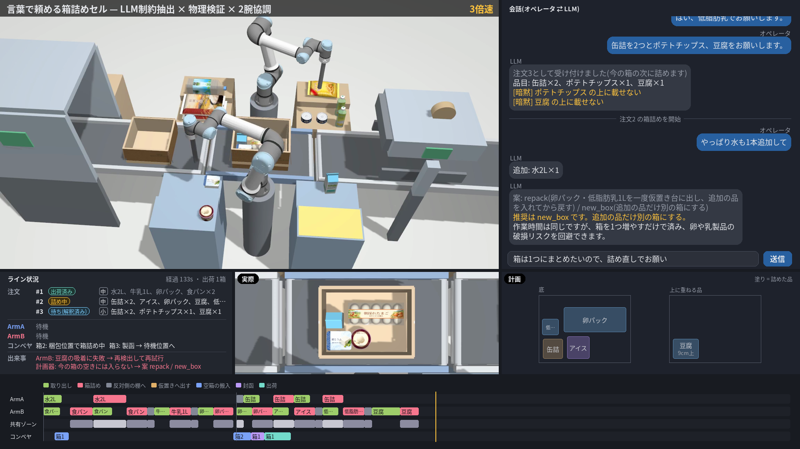
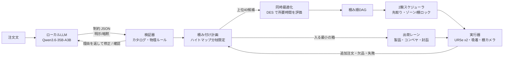

# pack-cell — 言葉で頼める箱詰めセル

ネットスーパーの出荷レーンを想定し、オペレータが自然言語で頼んだ注文（「牛乳と食パンを2つ、卵、水をお願いします。卵は最後に」）を、コンベヤを挟んだ2台の UR5e が協調して箱詰めするシミュレーションです。シミュレータは Gazebo Harmonic、制御は ROS 2 Jazzy、言語理解はローカル LLM を使います。



- 製函機（注文に合わせて小・中・大の箱を選ぶ）→ コンベヤで梱包位置へ → 2台で棚からピッキングして崩れない積み付け → 封函機でフラップを閉じる → 出荷、を連続注文で流す
- **LLM は解釈と提案だけ**を担当する。位置・順序・物理的な成立性はアルゴリズムが決めて検証するので、LLM の誤りがロボットに届かない。代替品や再計画の最終判断はオペレータが返信で行う
- 欠品（代替品の提案と承認）、吸着の失敗（再試行）、作業中の追加注文（最小限の積み直し）に対応する

設計の詳細は [docs/design.md](docs/design.md) にあります。

## 全体の流れ



| 部品 | 内容 | 場所 |
|---|---|---|
| 制約の語彙 | `before` `first` `last` `layer` `on` `not_on` `nothing_on` `group` `separate`。明示（hard）と暗黙（soft） | `src/pack_cell/core/order.py` |
| 物理ルール | 底面の80%以上を支える・段差1cm以内・耐荷重（重さを下の品へ伝えて全段で確認）・箱の高さ・非食品を食品の上に置かない（常に hard） | `src/pack_cell/core/planner.py` |
| 積み付け計画 | 実寸の品を、箱の内側の1cm刻みのハイトマップ上にビームサーチで配置（水平の向き 0°/90°）。小 → 中 → 大の順に試して入る最小の箱を選ぶ。解がなければ「満たせない理由」を返す。追加注文では上の品を最小個数だけ取り出す案も探す | 同上、`src/pack_cell/app.py` |
| 2腕スケジューラ | 逐次（S0）/ 固定分担（S1）/ 提案（S2: 先取り＋トポロジカル順の共有ゾーンの付与＋反対側の棚への移動を短い行動に分けてゾーンを短く占有）。デッドロックしない先取り条件 | `src/pack_cell/core/scheduler.py` |
| 出荷レーン | 入口・梱包・出口の3区間のコンベヤ（TrackController）、製函機（注文のサイズの空箱を出す）、封函機（フラップ4枚を関節で閉じる）。次の注文の箱の搬入と前の箱の封函・出荷を、箱詰めと並行して行う | `src/pack_cell/sim/line.py`, `sim/gen_world.py` |
| 同時最適化 | 物理コスト上位の配置候補を、離散イベントシミュレーションの所要時間で選び直す | `src/pack_cell/core/joint.py`, `des.py` |
| LLM | JSON スキーマで出力を縛り、応答を記録・再生（record/replay）。注文・修正・追加注文・代替品・選択肢の説明 | `src/pack_cell/llm/` |
| 品物 | 実寸の11品目（水2L・米2kg・缶詰・洗剤・ポテトチップス・牛乳・低脂肪乳・豆腐・アイス・卵10個パック・食パン）。見た目は寸法から生成した OBJ メッシュに、生成 AI で作った架空ブランドの商品ラベルを貼る。衝突は実寸の直方体・円柱。棚には品目ごとに重ねるか並べて2個ずつ（牛乳は最後の1本） | `config/catalog.yaml`, `sim/meshes.py`, `assets/labels/` |
| 箱 | 小 32×30×16cm・中 40×30×22cm・大 44×32×26cm。フラップ付き（開いて外へ垂れ下がり、封函機で閉じる） | `src/pack_cell/layout.py` |
| ロボット | UR5e の IK、関節空間の搬送と直線の接近、吸着（DetachableJoint）、失敗の検知 | `src/pack_cell/robot/` |
| 知覚 | 棚の天井の 3D バウンディングボックスカメラ（Gazebo）で、品ごとのラベル番号から位置・向き・寸法を得る。重ねた品は高さから段数を求める。腕で隠れた品・欠品は映らない | `src/pack_cell/perception/bbox.py`, `src/pack_cell/sim/world.py` |
| 可視化 | 実行ログと録画からの説明付き動画の合成（俯瞰・チャット・ライン状況・箱の真上と配置図・ガント） | `src/pack_cell/viz/` |

## 動かし方

前提:

- arm64 の Linux と NVIDIA GPU（カメラの描画に使う）、Docker と NVIDIA Container Toolkit
- LLM は任意です。注文の解釈の応答は `data/llm_cache.jsonl` に記録してあるので、収録済みのシナリオは LLM なしで動きます（`LLM_MODE=replay` にすると、記録にない問い合わせはエラーにします）。新しい注文文を試すときは、ホストで OpenAI 互換の LLM サーバを `http://127.0.0.1:30000/v1` に立ててください（llama.cpp + Qwen3.6-35B-A3B Q4_K_XL で確認。`LLM_BASE_URL` で変えられます）

```bash
./scripts/docker_build.sh                                  # イメージ pack-cell:jazzy を作る
./scripts/docker_run.sh python3 -m pytest -q tests         # 計画・スケジューラのテスト

# 3件の連続注文(欠品と代替の承認・吸着の失敗・追加注文による積み直しを含む)を Gazebo で実行して録画する(ヘッドレス)
LLM_MODE=replay ./scripts/run_sim.sh -- python3 -u scripts/run_order.py --scenario lane --name demo --record
# 説明付きの動画を作る(logs/video/demo_final.mp4)
./scripts/docker_run.sh python3 scripts/make_video.py demo --speed 3

# 1件だけの注文
LLM_MODE=replay ./scripts/run_sim.sh -- python3 -u scripts/run_order.py --scenario order1 --name demo1
# 新しい注文文(LLM サーバが必要)
./scripts/run_sim.sh -- python3 -u scripts/run_order.py --text "牛乳と食パン。パンは潰さないで"
```

実行ログは `logs/runs/<name>.json`、録画は `logs/video/` に出ます。`--gui` を付けると Gazebo の GUI も開きます（`DISPLAY` が必要）。

## 評価

| ID | 内容 | 実行 |
|---|---|---|
| E1 | 言語理解: 正解付き30文で、LLM 単独と LLM＋検証器を比べる | `./scripts/docker_run.sh python3 eval/run_lang_eval.py` |
| E2 | 協調: 3注文 × 4戦略 × 3シードを Gazebo で実行する | `python3 eval/run_sched_eval.py --extra=--no-ship` |
| E3 | ロバスト性: 吸着の失敗率を変えて完遂率と時間を見る | `python3 eval/run_sched_eval.py --orders order3 --strategies S2J --prefix e3p20 --extra "--no-ship --fail-prob 0.2"` |
| 集計 | 表とグラフ | `./scripts/docker_run.sh python3 eval/analyze.py` |

結果は [results/](results/) にあります（詳細は `results/summary.md`、各回の値は `results/e2_runs.csv`）。

### E2 2腕協調（Gazebo、3注文 × 4戦略 × 3シード、36回すべて成功）

| 注文 | S0 逐次 | S1 固定分担 | S2 提案 | S2＋同時最適化 | 短縮 |
|---|---|---|---|---|---|
| 注文1（5点・卵は最後、中の箱） | 76.5s | 69.4s | **53.7s** | 54.5s | 30% |
| 注文2（5点・冷たいものはまとめて、中の箱） | 81.8s | 66.3s | 60.0s | **59.4s** | 27% |
| 注文3（8点、大の箱） | 114.7s | 100.0s | **80.8s** | 81.6s | 30% |

所要時間は、注文の開始から全品を詰め終えるまでのシミュレーション時刻の平均（各3シード。空箱がコンベヤで届くまでの待ちを含み、封函・出荷は含まない）。実測で校正した DES の予測誤差は平均 4.7%（最大 9.3%）。

### E3 吸着失敗の注入（注文3、S2＋同時最適化）

| 失敗率 | 成功 | 所要時間 |
|---|---|---|
| 0% | 3/3 | 81.6s |
| 20% | 3/3 | 87.8s |
| 40% | 3/3 | 91.5s |

### E1 言語理解（30文: 明示10・暗黙10・言い換え5・矛盾5）

| 指標 | LLM 単独 | LLM＋検証器 |
|---|---|---|
| 品目・数量の正解率 | 100% | 100% |
| 明示の制約の抽出（F1） | 0.97 | 1.00 |
| 矛盾・不可能な指示の検出率 | 20% | **100%** |
| 正常な指示を誤って聞き返す率 | 0% | 0% |
| 平均応答時間 | 2.00秒 | 2.49秒 |

## ディレクトリ

```
assets/      商品ラベル画像
config/      品物カタログ・シナリオ
data/        LLM の応答の記録
docker/      Dockerfile
docs/        設計書・商品ラベルの生成プロンプト
eval/        評価セットと実験スクリプト
results/     評価結果
scripts/     起動・実行・動画の合成
sim/         ワールド生成・URDF・launch
src/pack_cell/
  core/      注文・計画・DAG・スケジューラ・DES(ROS 非依存)
  llm/       LLM クライアントとプロンプト
  robot/     UR5e の IK・動作・吸着スキル
  perception/ 棚の 3D バウンディングボックスカメラ
  coord/     実行器
  sim/       Gazebo とのやり取り・ワールド管理・出荷レーン・録画
  viz/       動画の合成
tests/       pytest
```

## 限界

- 段ボールの組み立て、不定形物、実機は対象外（空箱は製函機の出口から出てくる想定）。
- 吸着は DetachableJoint による模擬で、吸着できるかどうかは位置ずれで判定している。封函機のフラップは見た目だけの関節で、テープは長いフラップの表に付けてあり閉じると現れる。
- 品物は剛体で、袋の変形は扱わない。上から吸うので、棚と箱で上を向く面は変えられない。
- 知覚はシミュレータのバウンディングボックスカメラに頼っており、誤差は実質ゼロ。
- 2台の干渉回避は、共有ゾーンのロック・高さの層分け・待機位置の規則による。経路の衝突検査はしていない。
- 今のレイアウトでは両方のアームが届く棚がないため、配置とスケジュールの同時最適化（S2J）の効果はほぼない。
- E1 の評価文は自作の30文で、作者と評価者が同じ。
- 吸着ジョイントは URDF に入れて起動時に解除している。解除の取りこぼしに備えて、物理的な確認と起動し直しの仕組みを残している。

## 商品ラベル画像について

`assets/labels/` の商品ラベルは、作者が画像生成 AI で作った架空ブランドのデザイン（文字なし）に、比率の調整と日本語の商品名・成分表の重ね書きをしたものです（加工は `scripts/prepare_labels.py`。生成した元画像は含めていません）。実在の商品・ロゴは使っていません。生成に使ったプロンプトは [docs/label_prompts.md](docs/label_prompts.md) にあります。

## 使ったもの

ROS 2 Jazzy, Gazebo Harmonic, Universal Robots の `ur_description` / `ur_simulation_gz`, llama.cpp, Qwen3.6-35B-A3B。

## ライセンス

[MIT](LICENSE)
